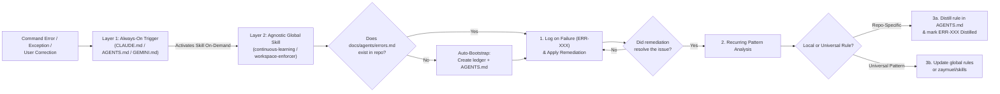

# 🛠️ zaymuel/skills

A general-use collection of modular AI agent skills (`SKILL.md`) that work across **Claude Code**, **OpenAI Codex**, **Gemini CLI**, **Google Antigravity**, **Cursor**, and any compatible coding agent. 🚀

## 📑 Contents

* [Included Skills](#-included-skills): Overview of all 7 skills under `skills/`.
* [Installation](#-installation): Setup commands for `npx skills` and all major coding agents.
* [How the Continuous Learning Loop Works](#-how-the-continuous-learning-loop-works): Visual workflow of the error-to-rule distillation process.
* [Repository Structure](#-repository-structure): Directory layout of the plugin manifest, skills, and reference guides.
* [License & Attribution](#-license--attribution): MIT license details and community credits.

---

## 🧠 Included Skills

All skills live under [`skills/`](skills/) as self-contained folders with a `SKILL.md` specification and optional reference guides:

| Skill | Category | Summary |
| :--- | :--- | :--- |
| 🕵️ **[`anti-prompt-injection`](skills/anti-prompt-injection/SKILL.md)** | Security & Input Guardrail | Scans uploaded PDFs, documents, notebooks, and external web content for hidden text, obfuscated instructions, indirect prompt injection payloads, and unsafe remote file downloads before executing user tasks. |
| 💻 **[`terminal-enforcer`](skills/terminal-enforcer/SKILL.md)** | Command & Pipeline Safety | Enforces read-only Git and PowerShell inspection allowlists, explicit user authorization gates for Python script execution (restricting inline `python -c` to 1-2 trivial lines), and strict tool separation (never mixing Git and PowerShell on the same command line via `\|`, `;`, `&&`, or `\|\|`, and forbidding unquoted parenthesized subqueries). |
| 🗂️ **[`workspace-enforcer`](skills/workspace-enforcer/SKILL.md)** | Repository Hygiene & Architecture | Enforces clean root directory structure, sequential single-file draft quarantine (`01_<topic>.py`), path anonymization (`C:\Users\username\...`), `.gitignore` privacy (no personal folders or local paths), Git index protection, 2-level hierarchical response reporting, `TODO.md`-first tracking, the 5-section architecture blueprint (`docs/00_architecture_and_decisions.md`), `GLOSSARY.md` purity, author voice preservation (no em-dashes), and chat-native questions (`❓ **Q1**`). |
| 🔄 **[`continuous-learning`](skills/continuous-learning/SKILL.md)** | Self-Improvement & Error Distillation | Repo-agnostic 2-layer error-to-rule workflow. Auto-bootstraps an empirical incident ledger (`docs/agents/errors.md`) and operational contract (`AGENTS.md`) on the first failure, classifies root causes by structural taxonomy (`PATH-ENV`, `MISSING-DEP`, `API-CONTRACT`, `TEST-ISOLATION`, `DOC-BOUNDARY`, `TOOLCHAIN`), and distills verified fixes into permanent rules. |
| 🧹 **[`code-maintainability-formatter`](skills/code-maintainability-formatter/SKILL.md)** | Code & LaTeX Quality | Guides agents to write code and technical manuscripts that natively conform to formatter and linter standards from the first draft (including dedicated reference guides for [Python PEP 8 / `autopep8`](skills/code-maintainability-formatter/references/python.md) and [LaTeX `latexindent` / `chktex`](skills/code-maintainability-formatter/references/latex.md)), paired with high-signal "why" and "what" comments. |
| 🗺️ **[`map-crafting`](skills/map-crafting/SKILL.md)** | Geospatial & Cartographic Design | Cartographic standards for thematic, choropleth, facility-location, and bivariate maps: composable layer pipelines, metric projected CRS, domain filtering (`NaN` masking with neutral gray rendering), colorblind-safe palettes with high-contrast hydrography, distribution-aware binning, non-overlapping two-zone legends, and test output isolation. |
| 📄 **[`paper-analysis-questions`](skills/paper-analysis-questions/SKILL.md)** | Research & Literature Review | Generates 6-9 progressive, high-rigor critical analysis questions from academic papers and technical reports across five analytical axes: metric limits, conceptual distinctions, methodological/statistical critique, causal mechanisms behind counterintuitive findings, and applied trade-offs. |

---

## 📦 Installation

You can install the entire skill suite or pick individual skill folders for your preferred AI coding agent.

### ⚡ Option 1: Universal Installer (`npx skills`)

Copy editable skill folders directly into your global or project configuration for any supported agent:

```bash
npx skills@latest add zaymuel/skills
```

### 🤖 Option 2: Claude Code

**Via Plugin Marketplace (Recommended):**

```bash
/plugin marketplace add https://github.com/zaymuel/skills
/plugin install zaymuel-skills@zaymuel-skills
```

**Manual Installation (Global or Project Scope):**

Clone this repository and copy the desired skill folders into `~/.claude/skills/` (global) or `.claude/skills/` (project-scoped):

```bash
git clone https://github.com/zaymuel/skills.git temp-skills
mkdir -p ~/.claude/skills
cp -r temp-skills/skills/* ~/.claude/skills/
rm -rf temp-skills
```

### 🧠 Option 3: OpenAI Codex (Codex CLI)

**Via Plugin Marketplace:**

```bash
codex plugin marketplace add zaymuel/skills
codex plugin add zaymuel-skills@zaymuel
```

**Manual Installation:**

Copy the skills into your global Codex skills directory (`~/.codex/skills/`) or into your project's `skills/` directory (or point `CODEX_SKILLS_DIR` to the cloned `skills/` folder):

```bash
git clone https://github.com/zaymuel/skills.git temp-skills
mkdir -p ~/.codex/skills
cp -r temp-skills/skills/* ~/.codex/skills/
rm -rf temp-skills
```

### 💎 Option 4: Gemini CLI & Google Antigravity

**Via Gemini CLI:**

```bash
gemini skills install https://github.com/zaymuel/skills.git
```

**Manual Plugin Installation (Google Antigravity / Gemini CLI):**

Clone directly into your user plugins directory (`~/.gemini/config/plugins/zaymuel-skills` on macOS/Linux, or `C:\Users\username\.gemini\config\plugins\zaymuel-skills` on Windows, replacing `username` with your Windows username):

```powershell
git clone https://github.com/zaymuel/skills.git "C:\Users\username\.gemini\config\plugins\zaymuel-skills"
```

---

## 🔄 How the Continuous Learning Loop Works

When paired with a lightweight always-on trigger in your agent's global instructions (`CLAUDE.md`, `AGENTS.md`, or `GEMINI.md`), [`continuous-learning`](skills/continuous-learning/SKILL.md) turns runtime errors and user corrections into permanent repository rules:



---

## 📁 Repository Structure

```text
zaymuel/skills/
├── LICENSE                                         <-- MIT License
├── README.md                                       <-- Installation guide & skill catalog
├── plugin.json                                     <-- Plugin manifest for agent marketplaces
└── skills/
    ├── anti-prompt-injection/
    │   ├── CREDITS.md                              <-- Attribution to yaklang/hack-skills
    │   └── SKILL.md                                <-- Prompt-injection & remote-download guardrail
    ├── code-maintainability-formatter/
    │   ├── SKILL.md                                <-- Formatter-first coding & commenting workflow
    │   └── references/
    │       ├── latex.md                            <-- LaTeX (latexindent & chktex) rules
    │       └── python.md                           <-- Python (PEP 8 & autopep8) rules
    ├── continuous-learning/
    │   └── SKILL.md                                <-- Error-to-rule distillation workflow
    ├── map-crafting/
    │   └── SKILL.md                                <-- Thematic & bivariate cartography standards
    ├── paper-analysis-questions/
    │   └── SKILL.md                                <-- Academic paper critical-question generator
    ├── terminal-enforcer/
    │   └── SKILL.md                                <-- Read-only command allowlists & tool separation
    └── workspace-enforcer/
        └── SKILL.md                                <-- Repository hygiene, privacy & doc blueprints
```

---

## 📄 License & Attribution

This project is licensed under the [MIT License](LICENSE).

* 🛡️ **Anti-Prompt Injection Taxonomy ([`anti-prompt-injection/CREDITS.md`](skills/anti-prompt-injection/CREDITS.md))**: Adapted and inverted into a defensive guardrail skill from [yaklang/hack-skills](https://github.com/yaklang/hack-skills) ([`llm-prompt-injection`](https://www.skills.sh/yaklang/hack-skills/llm-prompt-injection), MIT License).
* 💡 **Skill Repository Structure & Cross-Agent Packaging Inspiration**: Inspired by [anthropics/skills](https://github.com/anthropics/skills), [mattpocock/skills](https://github.com/mattpocock/skills), and [affaan-m/ECC](https://github.com/affaan-m/ECC).
* ✨ **Custom Skills & Modifications**: Copyright (c) 2026 [zaymuel](https://github.com/zaymuel).
