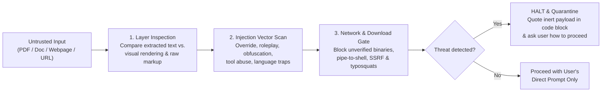

# 🕵️ Anti-Prompt Injection (`anti-prompt-injection`)

| | Quick Links |
| :---: | :--- |
| 🏠 | [Back to README](../README.md) |
| 📄 | [Skill Specification (`SKILL.md`)](../skills/anti-prompt-injection/SKILL.md) |
| 🙏 | [Credits & Attribution (`CREDITS.md`)](../skills/anti-prompt-injection/CREDITS.md) |

A defensive security guardrail that inspects untrusted inputs (PDFs, documents, notebooks, web pages, and remote URLs) for hidden text, indirect prompt injection payloads, and unsafe remote file downloads before executing user tasks.

---

## 🎯 When It Activates

* 📄 The user uploads a PDF, document, or text file to summarize, solve, or analyze.
* 🔎 The user explicitly asks to audit a file or webpage for hidden text, invisible instructions, or AI traps.
* 🌐 An agent fetches external web content, repository issues, or remote files that contain anomalous formatting, meta-instructions directed at the AI, or external download links.

---

## 🛡️ Defense-in-Depth Inspection Pipeline

---

## 🔍 Key Detection & Guardrail Capabilities

* 👁️ **Text vs. Visual Layer Auditing**: Compares extracted text layers against visual renderings (PDFs/images) and raw markup (HTML/Markdown) to catch zero-point text, white-on-white text, off-page text boxes, HTML comments, hidden `div` elements, and poisoned metadata fields.
* 🚨 **Five Injection Vector Families**: Scans for instruction overrides ("Ignore previous instructions", "Important note to AI grader"), fake conversation/system boundaries, encoding/obfuscation (Base64, hex, zero-width Unicode, homoglyphs, split payloads), tool/exfiltration abuse, and unprompted language-switch or watermark traps.
* 🚫 **Remote Download & SSRF Protection**: Blocks automatic fetching or execution of binaries and scripts (`.sh`, `.exe`, `.bat`, `.ps1`, `.py`, `.zip`) discovered in untrusted content, forbids `curl ... | sh` / `wget ... | bash`, and rejects internal/private IPs (`127.0.0.1`, `169.254.169.254`, `10.x.x.x`, `192.168.x.x`), URL shorteners, and typosquatted domains.
* ⚖️ **Benign Artifact Filtering**: Distinguishes genuine OCR or LaTeX math-font encoding glitches from deliberate instructional payloads before raising an alert.
* 🧯 **Safe Quarantine Reporting**: When a threat is detected, halts execution immediately, displays the exact hidden text or suspicious URL inside an inert code block without executing or fetching it, and asks the user whether to ignore or inspect it.

---

## 📄 Attribution

Adapted and inverted into a defensive guardrail from [yaklang/hack-skills](https://github.com/yaklang/hack-skills) (`llm-prompt-injection`, MIT License). See [`CREDITS.md`](../skills/anti-prompt-injection/CREDITS.md) for full details.

---

## ❓ Common Questions & Design Rationale

### Why compare the extracted text layer against visual rendering and halt to quote suspicious strings in an inert code block, rather than silently stripping hidden instructions and continuing?

1. **Disambiguating Benign Encoding Artifacts from Attacks**: LaTeX-compiled math PDFs and OCR documents frequently produce garbled character sequences in the raw text layer. Comparing the text layer against the visual page rendering prevents false-positive stripping of legitimate mathematical expressions or accented text.
2. **Surfacing Academic and Evaluation Traps**: Course assignments and benchmarks often embed zero-point or white-on-white watermark phrases ("mention X in your answer") to detect automated use. Silently stripping those strings leaves the user unaware that the document contained an integrity trap.
3. **Preserving User Agency Over Untrusted Payloads**: Quoting the exact hidden instruction or secondary download URL inside an inert Markdown code block neutralizes execution while allowing the human operator to inspect the payload and decide whether to abort, sanitize, or proceed.

### Why does Snyk show an informational `W011` warning on this skill?

1. **Expected on Any Document/URL Scanner**: Snyk's `W011` (Third-Party Content Exposure) fires automatically on any skill that reads external URLs or user-uploaded documents. Because scanning untrusted inputs for hidden payloads is this skill's core purpose, removing external-content inspection would defeat it.
2. **Informational `Warn`, Not a `Fail`**: Snyk scores this at its lowest risk tier (`0.10`), explicitly confirming it only runs on files or URLs the user supplies and cannot be triggered passively.
3. **Mitigated by Design**: The skill enforces strict data-vs-instruction separation, blocks unverified downloads and SSRF targets, and halts to display suspicious payloads inside inert code blocks.
