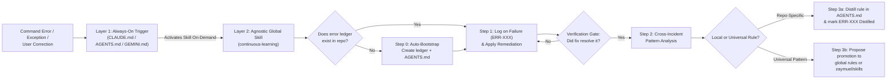

# 🔄 Continuous Learning (`continuous-learning`)

| | Quick Links |
| :---: | :--- |
| 🏠 | [Back to README](../README.md) |
| 📄 | [Skill Specification (`SKILL.md`)](../skills/continuous-learning/SKILL.md) |

A repository-agnostic, two-layer error-to-rule distillation loop that turns command failures, unexpected exceptions, and user corrections into permanent preventive policies.

---

## 🎯 When It Activates

This skill activates automatically before retrying or proceeding whenever any of the following occurs:

* ❌ A shell command, build step, script, or test returns a non-zero exit code or raises an unexpected exception.
* 🔍 The agent references a non-existent symbol, config constant, dependency, or wrong schema from assumption instead of inspection.
* ⚠️ A test mutates or overwrites production files or result directories.
* 🗣️ The user corrects a recurring mistake or points out a boundary violation (documentation hygiene, path assumptions, tool separation, etc.).

---

## 🏗️ Two-Layer Architecture & Execution Loop

Instead of bloating global system prompts with project-specific fixes, continuous learning splits responsibility into two layers:

1. **Layer 1 (Always-On Trigger)**: A lightweight (~4-line) directive in your global agent instructions (`CLAUDE.md`, `AGENTS.md`, or `GEMINI.md`) that watches for failures and corrections with minimal token overhead.
2. **Layer 2 (On-Demand Agnostic Skill)**: Loaded via progressive disclosure only when an incident occurs, handling ledger bootstrapping, root-cause taxonomy, verification, and rule distillation.

---

## 📚 Complementary Non-Overlapping Files

Every repository maintains two clean, separated files so raw debugging logs never pollute active operational rules:

| File | Functional Role | What Belongs Here | What Does NOT Belong Here |
| :--- | :--- | :--- | :--- |
| **`docs/agents/errors.md`** *(or local `.agents/errors.md`)* | **Incident Ledger & Empirical Memory** (*why rules exist*) | Chronological `ERR-XXX` entries with exact commands, error messages, root causes, fixes, and structural categories (`[TOOLCHAIN]`, `[PATH-ENV]`, `[MISSING-DEP]`, `[API-CONTRACT]`, `[TEST-ISOLATION]`, `[DOC-BOUNDARY]`, `[SYMBOL-CHECK]`, `[DATA-SCHEMA]`). | Prescriptive workflow mandates mixed into raw log tables without synthesis. |
| **`AGENTS.md`** | **Enforced Operational Contract** (*what the agent must obey*) | Concise, imperative, testable preventive rules promoted only after a fix passes the **Verification Gate**. | Raw stack traces, historical command logs, or unverified hypotheses. |

---

## ✅ Promotion Criteria (Verification Gate)

* 🔁 **Recurrence Threshold**: Two or more incidents sharing the same abstract failure mode or structural category trigger distillation into a permanent rule.
* 🚨 **High-Severity / Explicit Correction**: Critical silent failures (such as silent data corruption or destructive overwrites) or explicit user corrections promote immediately once the remediation is verified.
* 🧪 **Never Distill Unverified Hypotheses**: A rule is only promoted to `AGENTS.md` or global skills after the retried command, build, or test succeeds without regression.

---

## ❓ Common Questions & Design Rationale

### Why split self-improvement into an empirical error ledger (`errors.md`) and a separate operational contract (`AGENTS.md`) gated by a verification check, rather than appending every bug fix directly to the global system prompt?

1. **Preventing System-Prompt Drift and Unverified Rules**: During multi-step debugging, an agent's first hypothesis about a failure is often incomplete or wrong. Immediately writing an unverified fix into `AGENTS.md` or global instructions locks in brittle or contradictory rules. The **Verification Gate** ensures only remediations that demonstrably pass tests or recurrence checks ($\ge 2$ incidents) graduate into enforced policy.
2. **Separating Empirical Memory (*Why*) from Imperative Contract (*What*)**: Raw stack traces, command logs, and one-off environment quirks provide essential historical context in `errors.md`, but they waste tokens and dilute attention if loaded into every turn's operational contract. Keeping `AGENTS.md` restricted to concise, imperative rules maximizes agent compliance while preserving the full audit trail in `errors.md`.
