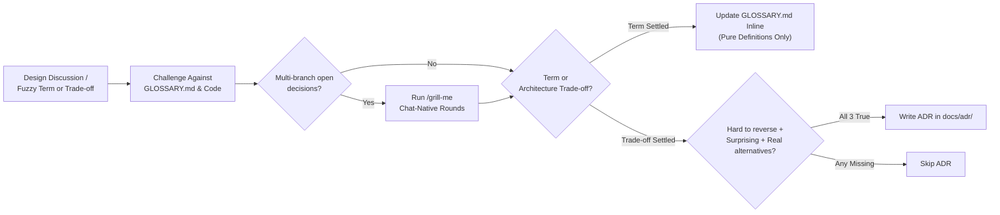

# 🧩 Domain Modeling (`domain-modeling`)

| | Quick Links |
| :---: | :--- |
| 🏠 | [Back to README](../README.md) |
| 📄 | [Skill Specification (`SKILL.md`)](../skills/domain-modeling/SKILL.md) |
| 🙏 | [Credits & Attribution (`CREDITS.md`)](../skills/domain-modeling/CREDITS.md) |
| 📖 | [Glossary Format (`GLOSSARY-FORMAT.md`)](../skills/domain-modeling/GLOSSARY-FORMAT.md) |
| 📑 | [ADR Format (`ADR-FORMAT.md`)](../skills/domain-modeling/ADR-FORMAT.md) |

Actively sharpens a project's vocabulary (`GLOSSARY.md`) and records hard-to-reverse architectural trade-offs (`docs/adr/`) the moment they are settled during design.

---

## 🎯 When It Activates

This skill opens when you and the agent are actively shaping or changing a project's concepts:

* 🗣️ Naming new domain entities or debating fuzzy, overloaded terms ("account" vs. "customer" vs. "user").
* 📚 Creating or updating `GLOSSARY.md` (or multi-context `GLOSSARY-MAP.md`).
* 🏛️ Recording an Architectural Decision Record (ADR) in `docs/adr/` for a major design trade-off.

---

## 💡 How It Works (Plain English)

Instead of letting vague terms creep into code or writing bloated specs nobody reads, `domain-modeling` keeps your vocabulary and decisions crisp in real time:

1. **Challenge and Sharpen**: Catches contradictions against `GLOSSARY.md` or existing code and pushes vague words into one canonical name.
2. **Update `GLOSSARY.md` Immediately**: Writes resolved definitions inline while keeping `GLOSSARY.md` 100% free of implementation details.
3. **Gate ADRs Strictly**: Only proposes an ADR when a decision passes all three filters: hard to reverse, surprising without context, and chosen over genuine alternatives.

---

## 🧪 Concrete Example

1. **The confusion**: During a checkout redesign, you say *"cancel the account"* when the codebase actually cancels a single *Order*.
2. **Sharpened inline**: The agent surfaces the contradiction, settles the distinction between `Account`, `Customer`, and `Order`, and updates `GLOSSARY.md` immediately without mixing in database table names.
3. **Selective ADR**: If you also switch orders to event sourcing (hard to reverse, surprising without context, weighed against CRUD), it records `docs/adr/0001-event-sourced-orders.md`; routine library picks skip ADRs.

---

## ❓ Common Questions & Design Rationale

### Why keep `GLOSSARY.md` completely devoid of implementation details and gate ADRs behind three strict criteria?

1. **Timeless Shared Language**: Mixing file paths, framework flags, or database schemas into `GLOSSARY.md` makes definitions rot every time code is refactored; pure domain concepts stay accurate for both humans and agents.
2. **Preventing ADR Fatigue**: Writing an ADR for every minor choice buries the few irreversible trade-offs future maintainers actually need to understand.
