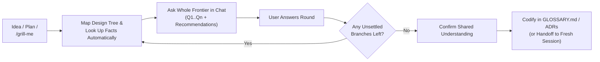

# 🔥 Grilling (`grilling`)

| | Quick Links |
| :---: | :--- |
| 🏠 | [Back to README](../README.md) |
| 📄 | [Skill Specification (`SKILL.md`)](../skills/grilling/SKILL.md) |
| 🙏 | [Credits & Attribution (`CREDITS.md`)](../skills/grilling/CREDITS.md) |

Stress-tests a plan, feature, or architectural decision through structured, chat-native interview rounds until every branch of the design tree is settled.

---

## 🎯 When It Activates

This skill opens when you want the agent to poke holes in an idea before writing code:

* 💬 Invoking `/grill-me` or using any `"grill"` trigger phrase.
* 🧠 Stress-testing a feature spec, refactor plan, or security fix with multiple open trade-offs.

---

## 💡 How It Works (Plain English)

Rather than asking one vague question at a time or silently guessing your preferences, `grilling` treats your design like a decision tree:

1. **Find Facts First**: The agent looks up codebase facts itself (via tools or sub-agents) so it never wastes your time asking what files or configs already say.
2. **Ask the Whole Frontier in One Round**: Groups every decision whose prerequisites are settled into numbered chat prompts (`❓ **Q1**` / `➡️ <recommendation>`), worded so `"yes"` accepts the recommendation.
3. **Wait and Recompute**: Your answers unlock the next layer of dependent decisions; the loop ends only when nothing is left silently assumed and you confirm shared understanding.

---

## 🧪 Concrete Example

1. **The trigger**: You run `/grill-me` after a Snyk audit flags a skill for deleting files without asking.
2. **Frontier round**: The agent reads the repo first, discovers the exact same phrasing in a sibling skill, and asks Q1 (cleanup policy), Q2 (sync sibling skill), and Q3 (file destination) in one chat round with clear recommendations.
3. **Settled execution**: You reply `q1 1, q2 yes, q3 yes`, the frontier empties, and the agent applies the exact agreed changes with zero guesswork.

---

## ❓ Common Questions & Design Rationale

### Why ask the entire decision frontier in chat-native rounds with recommended answers instead of asking one question at a time or using UI popup buttons?

1. **Fewer Turns Without Premature Guessing**: Batching all independent questions cuts back-and-forth latency, while deferring dependent questions to the next round prevents speculative branching.
2. **Fast Default Approval Without Accidental Popup Submissions**: Pairing each question with a recommended answer worded for `"yes"` lets you confirm straightforward choices in plain chat, avoiding modal UI popups where pressing Enter to queue a prompt can accidentally submit an unintended answer to a design question.
