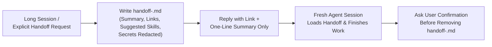

# 🤝 Session Handoff (`handoff`)

| | Quick Links |
| :---: | :--- |
| 🏠 | [Back to README](../README.md) |
| 📄 | [Skill Specification (`SKILL.md`)](../skills/handoff/SKILL.md) |
| 🙏 | [Credits & Attribution (`CREDITS.md`)](../skills/handoff/CREDITS.md) |

Compacts a long conversation into a concise, self-contained `handoff-<topic>.md` file so a fresh agent session can pick up the work without losing context.

---

## 🎯 When It Activates

This skill opens when you ask for a session handoff or when another skill (such as [`grilling`](grilling.md)) hands off a settled plan to a fresh session:

* 🧵 A conversation is getting long and you want to continue in a fresh context window.
* 🔀 You are handing off a settled design, debugging trail, or multi-step plan to another agent or model.

---

## 💡 How It Works (Plain English)

Instead of pasting huge chat logs into a new session, `handoff` writes a lean transfer brief:

1. **Topic-Named File**: Saves a kebab-case `handoff-<topic>.md` file (for example, `handoff-auth-refactor.md`) in the location allowed by your workspace rules (or OS temp dir if unconstrained).
2. **Links Over Duplication**: References existing specs, ADRs, commits, and diffs by path instead of copying them, redacts secrets/PII, and includes a `"Suggested Skills"` list for the next agent.
3. **Clean Chat & Safe Cleanup**: Replies only with a clickable link and one-line summary (no giant echo in chat). Once the next session finishes merging the handoff, it asks for explicit confirmation before removing the temporary file (unless workspace rules permit automatic cleanup).

---

## 🧪 Concrete Example

1. **End of Session 1**: After finishing an architecture interview, you ask for a handoff focused on *"implementing the OAuth callback tests"*. The agent writes `handoff-oauth-callback-tests.md`, links the relevant ADR and files, lists `tdd` and `workspace-enforcer` under Suggested Skills, and replies with just the file link.
2. **Start of Session 2**: A fresh agent reads `handoff-oauth-callback-tests.md`, loads the suggested skills, and implements the tests without needing the old chat history.
3. **Wrap-up**: Once the changes are integrated, the agent notifies you that the handoff is complete and asks whether to remove `handoff-oauth-callback-tests.md`.

---

## ❓ Common Questions & Design Rationale

### Why require kebab-case topic filenames and confirmation-gated cleanup instead of reusing one generic `handoff.md` or silently deleting consumed handoffs?

1. **Zero Collision Across Parallel Threads**: Topic-named files (`handoff-auth-refactor.md`) let multiple workstreams coexist without overwriting each other and make stale handoffs immediately recognizable.
2. **Safe, Auditable Artifact Lifecycle**: Asking for confirmation before removing a consumed handoff prevents accidental loss of unmerged notes (and avoids destructive autonomous file deletion) while still keeping repositories clutter-free.
