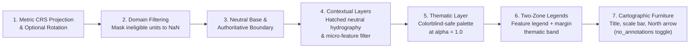

# 🗺️ Map Crafting (`map-crafting`)

| | Quick Links |
| :---: | :--- |
| 🏠 | [Back to README](../README.md) |
| 📄 | [Skill Specification (`SKILL.md`)](../skills/map-crafting/SKILL.md) |

Cartographic design and geospatial engineering standards for publication-grade thematic, choropleth, facility-location, and bivariate maps.

---

## 🎯 When It Activates

This skill activates whenever an agent creates, modifies, or reviews spatial map generators, choropleth figures, bivariate supply-demand maps, or point-location visualizations in any geospatial pipeline.

---

## 🧭 Composable Layer Pipeline

Every map generator follows a modular layer pipeline rather than duplicating plotting boilerplate:

---

## 🎨 Core Cartographic Standards

* 📐 **Metric Projected CRS & Authoritative Outer Boundary**: Projects all layers to a local metric CRS before computing areas, bounding boxes, or scale bars, renders thematic polygons at full opacity (`alpha=1.0`) so map fills match legend swatches identically, and overlays a dissolved authoritative outer boundary (`#222222`) even over synthetic tessellations (hex grids or rasters).
* 🩶 **Filter-to-`NaN`, Never Impute Zero**: Spatial units failing eligibility or minimum-denominator thresholds (such as uninhabited zones) are masked to `NaN` and rendered in light neutral gray (`#e5e7eb`, edge `#999999`), never coerced to `0` or colored in the lowest thematic bin.
* 🌈 **Luminance-First Colorblind-Safe Palettes (`colorblind: bool = True`)**: Defaults to perceptually uniform, CVD-safe palettes selected by data type:
  * **Sequential**: `cividis` (default), `viridis`/`magma`/`inferno`, or `Blues`.
  * **Diverging**: Blue-to-Orange / `PuOr`, `RdBu`/`RdYlBu`, or `BrBG` (strictly forbidding red-green `RdYlGn` ramps).
  * **Categorical**: Okabe-Ito 8-color palette or Paul Tol (`Bright`, `Muted`, `High-Contrast`).
* 🌊 **Non-Conflicting Contextual Layers & Redundant Encoding**: Styles water bodies and uninhabitable contextual barriers uniformly in neutral gray (`#e5e7eb`, edge `#6b7280`) with diagonal hatching (`hatch="////"`), filters out sub-scale micro-polygons so they aren't mistaken for point markers, and pairs color with line styles, shapes, or hatching for grayscale legibility.
* 📊 **Distribution-Aware Binning & 3x3 Bivariate Matrices**: Supports quantiles/deciles (`D1`..`D10`), zero-aware quantile bins (isolating `0` as an explicit bottom tier), magnitude brackets for heavy-tailed counts, and orthogonal 3x3 tertile bivariate matrices.
* 🏷️ **Two-Zone Non-Overlapping Legends & Clean Export Toggle**: Separates the contextual feature legend from a dedicated outer margin band for the primary thematic legend, and exposes `no_annotations: bool = False` across all generators for bare publication exports.
* 🧪 **Output Hygiene & Test Isolation**: Groups batch figure families into dedicated subdirectories and requires an explicit `output_path` so automated tests write exclusively to `tmp_path` without mutating production outputs.

---

## ❓ Common Questions & Design Rationale

### In thematic and bivariate cartography, how does coercing ineligible or zero-denominator spatial units to `0` instead of masking them to neutral-gray `NaN` distort quantile bins and visual interpretation?

1. **Statistical Distortion of Quantile and Tertile Thresholds**: When uninhabited zones, water bodies, or cells below a minimum exposure denominator are imputed as `0` rather than masked to `NaN`, those artificial zeros inflate the lower tail of the empirical distribution. In quantile (`D1`..`D10`) or 3x3 bivariate tertile classifications, this shifts bin boundaries downward and misclassifies genuinely underserved inhabited units into higher relative tiers.
2. **Visual Conflation of "No Data / Ineligible" with "Low Performance"**: Coloring excluded units in the lowest thematic ramp color (such as dark blue or red) misleads readers into perceiving uninhabited parks, industrial zones, or lakes as critical service-deficit areas. Rendering masked `NaN` polygons in neutral gray (`#e5e7eb`) visually isolates the valid study domain from excluded geography.
