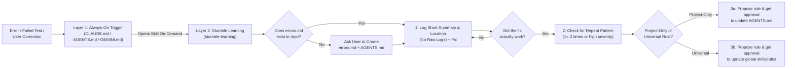

# 🔄 Stumble Learning (`stumble-learning`)

| | Quick Links |
| :---: | :--- |
| 🏠 | [Back to README](../README.md) |
| 📄 | [Skill Specification (`SKILL.md`)](../skills/stumble-learning/SKILL.md) |

Turns mistakes, failed commands, and user corrections into permanent, user-approved project rules without cluttering your global system prompt.

---

## 🎯 When It Activates

This skill stays closed during normal work and opens only when something goes wrong:

* ❌ A terminal command, build step, script, or test fails.
* 🔍 The agent guesses a file path, symbol, dependency, or data schema wrong.
* ⚠️ A test accidentally writes over production files.
* 🗣️ You correct a repeated mistake or point out a broken rule.

---

## 💡 How It Works (Plain English)

Instead of loading every project's bug history into every chat, `stumble-learning` uses two simple layers:

1. **Layer 1 (Tiny Always-On Watchdog)**: A short 4-line note in your global instructions (`CLAUDE.md`, `AGENTS.md`, or `GEMINI.md`) that tells the agent to open `stumble-learning` when something breaks.
2. **Layer 2 (The On-Demand Manual)**: The skill stays closed until an error happens. Once opened, it asks before creating an error log (`errors.md`), writes a short sanitized note of what failed and where, verifies the fix actually works, and asks your approval before turning repeat mistakes into a permanent rule (`AGENTS.md`).

---

## 🧪 Concrete Example (From Stumble to Rule)

1. **The stumble**: The agent chains a PowerShell command and a Git command on one line (`Get-ChildItem ...; git status`), and the user blocks it.
2. **Logged in `errors.md` (`ERR-001`)**: Records the exact command intent, root cause (`[TOOLCHAIN]` mixing PowerShell and Git with `;`), and the verified fix (running two separate parallel tool calls).
3. **Promoted to `AGENTS.md` (after user approval)**: Distills into one clean rule: *"Never combine PowerShell cmdlets and `git` commands on the same command line; issue separate parallel tool calls instead."*

---

## ❓ Common Questions & Design Rationale

### Why separate `errors.md` from `AGENTS.md` behind a verification gate instead of appending fixes directly to the global prompt?

1. **No Unverified Rules**: First debugging guesses are often wrong; requiring a passing fix and user approval keeps brittle or contradictory rules out of `AGENTS.md`.
2. **Low Token Noise & Safer Logs**: `errors.md` keeps sanitized incident history out of every prompt turn (and avoids pasting untrusted raw logs), leaving `AGENTS.md` strictly for short, enforceable rules.
