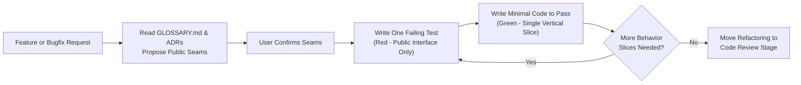

# 🧪 Test-Driven Development (`tdd`)

| | Quick Links |
| :---: | :--- |
| 🏠 | [Back to README](../README.md) |
| 📄 | [Skill Specification (`SKILL.md`)](../skills/tdd/SKILL.md) |
| 🙏 | [Credits & Attribution (`CREDITS.md`)](../skills/tdd/CREDITS.md) |
| ✅ | [Good vs. Bad Tests (`tests.md`)](../skills/tdd/tests.md) |
| 🎭 | [Mocking Guidelines (`mocking.md`)](../skills/tdd/mocking.md) |

Guides test-first development through vertical red-to-green slices at pre-agreed public seams so tests stay resilient across internal refactors.

---

## 🎯 When It Activates

This skill opens when you want to build features or fix bugs test-first:

* 🔴 Asking for test-driven development or mentioning `"red-green-refactor"`.
* 🧩 Writing integration-style tests against public module interfaces.
* 🐛 Reproducing a bug with a failing test before implementing the fix.

---

## 💡 How It Works (Plain English)

### What is a "seam"?

A **seam** is the public boundary where you interact with a piece of code without opening it up (such as a public function like `checkout(cart, paymentMethod)`, a CLI command, or an API endpoint). Think of a vending machine:

* **The seam (public interface)**: The coin slot, the keypad, and the pickup tray. You put in money, press `B4`, and check if chips drop out.
* **The internals (private code)**: The motors, springs, and wiring inside.

Instead of writing dozens of brittle unit tests up front against private internals, `tdd` keeps every cycle small, behavioral, and agreed upon:

1. **Agree on Seams First**: Before writing any test, the agent proposes which public seams to test, stating what each catches and misses, and waits for your confirmation.
2. **Work in Vertical Slices**: Writes one failing test (`red`), then only the minimal code needed to make it pass (`green`), letting each cycle guide the next rather than guessing all tests up front.
3. **Test Public Behavior, Not Internals**: Check what comes out of the public interface, not how private helper functions work inside, using independent expected values (never recomputing the implementation in the assertion or mocking internal collaborators). If you rewrite the internals later, your tests still pass.
4. **Test Combinations Together (Cartesian Coverage)**: When a feature has multiple options that can occur simultaneously (like a discount coupon and express shipping), parameterize tests over the full combinatorial suite (the full Cartesian product, or the upper/lower triangle when option order is symmetric to avoid redundant permutations) rather than stopping at isolated flags or pairwise-only checks. Bugs often hide where valid options collide..

---

## 🧪 Concrete Example

1. **Confirming the seam**: For a shopping cart checkout feature, the agent proposes testing at the public `checkout(cart, paymentMethod)` boundary (catching pricing and confirmation bugs, skipping private discount helpers) and gets your confirmation.
2. **Vertical slice + Cartesian combinations**: Writes one failing test (`"user can checkout with valid cart"`) asserting `result.status === "confirmed"`, then parameterizes over simultaneous flags (`couponApplied` x `expressShipping`) so option interactions are covered together.
3. **Survives refactoring**: Later, when internal pricing calculations are rewritten, the test suite still passes because it never mocked or inspected private methods.

---

## ❓ Common Questions & Design Rationale

### Why work in vertical slices at pre-agreed public seams instead of writing all tests first (horizontal slicing) against internal helpers?

1. **Tests That Survive Refactors**: Testing internal helpers or mocking private collaborators couples tests to code structure, so valid refactors break tests even when behavior is unchanged.
2. **Real Feedback Over Speculation**: Writing all tests up front locks you into imagined interfaces before you understand the implementation; one-test-at-a-time vertical slices act as tracer bullets that adapt to what each passing step reveals.

### Why parameterize tests over the Cartesian product of simultaneous options instead of testing each flag in isolation?

1. **Catching Hidden Option Interactions**: Bugs frequently appear only when two valid flags combine (such as `--log-scale` with `--no-annotations`, or a coupon with express shipping); isolated single-flag tests miss those cross-terms completely.
2. **Full Unordered Combinatorial Coverage Without Redundancy**: Covering the full Cartesian product (or the upper/lower triangle when option order is symmetric) tests the complete multi-option combination suite rather than stopping at pairwise testing (which is merely the 2-option special case), while avoiding duplicate symmetric permutations.
