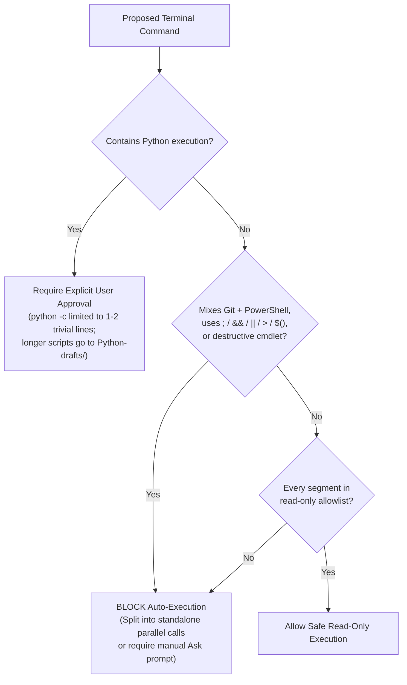

# 💻 Terminal Enforcer (`terminal-enforcer`)

| | Quick Links |
| :---: | :--- |
| 🏠 | [Back to README](../README.md) |
| 📄 | [Skill Specification (`SKILL.md`)](../skills/terminal-enforcer/SKILL.md) |

A command-execution and pipeline safety guardrail that accelerates read-only terminal inspection while strictly gating Python executions, file mutations, and shell chaining vectors.

---

## 🎯 When It Activates

This skill activates before the agent runs any terminal command across PowerShell, Git, or Python inside a workspace.

---

## ⚡ High-Velocity Read-Only Allowlist

A targeted allowlist of bounded, non-destructive commands speeds up daily development by eliminating repetitive permission prompts for safe read-only queries while keeping write, destructive, and script executions strictly gated:

* 🔍 **Read-Only Git Inspection**: Allows `git status`, `git log`, `git blame`, `git branch`, `git diff`, `git show`, `git ls-files`, and `git check-ignore` with safe relative paths. Mutating Git commands (`git add`, `git commit`, `git reset`, `git checkout`) are never executed autonomously.
* 🪟 **Read-Only PowerShell Cmdlets**: Allows PascalCase inspection and filtering cmdlets (`Get-ChildItem`, `Get-Content`, `Get-Item`, `Compare-Object`, `Measure-Object`, `Select-String`, `Test-Path`, `Get-Command`, `Get-Help`, `Select-Object`, `Where-Object`, `Sort-Object`, `Format-Table`, `Format-List`) with safe relative paths.
* 📄 **Safe Flat-File Inspection (`cat`)**: Restricts `cat` strictly to simple root-level filenames with `.txt`, `.md`, `.json`, or `.csv` extensions, blocking directory traversal (`../`).
* 🌐 **Zero-Argument Utilities & Diagnostics**: Permits standalone `pwd`, `Get-Process` (optionally piped into allowed read-only filters), and plain `ping <host>` without mutating flags.

---

## 🛡️ Pipeline Isolation & Python Execution Gates

* 🔀 **Strict Tool Separation (No Mixing Git and PowerShell)**: Agents must never combine `git` commands and PowerShell cmdlets on the same command line, whether via pipes (`|`) or command separators (`;`, `&&`, `||`). Independent checks must be issued as separate standalone `run_command` tool calls (run in parallel when batching) or handled with native IDE file tools.
* 🚫 **No Unquoted Subqueries or Redirection**: Prohibits unquoted parenthesized property wrappers (`(Get-Content README.md | Measure-Object -Line).Lines`), subexpressions (`$()`, `@()`, `()`), and output redirection (`>`, `>>`, `<`) in auto-executed commands.
* 🐍 **Gated & Bounded Python Execution**: Every Python execution requires explicit user authorization. Inline `python -c "..."` is strictly limited to 1 to 2 trivial lines; anything more complex must be written to `Python-drafts/` and invoked via `python "Python-drafts/<script>.py"`, while official workflows use canonical entry points (`python main.py ...`, `python scripts/<script>.py ...`) without throwaway wrappers.
* 🔐 **All-Stage Whitelist Gate**: If any segment in a pipeline or chained command contains an unlisted, state-modifying, or destructive cmdlet (`Remove-Item`, `Set-Content`, `Out-File`, `Move-Item`, `New-Item`, `Copy-Item`, `Rename-Item`, `Invoke-Expression`, `ForEach-Object`), the entire command line is blocked from automatic execution.

---

## ❓ Common Questions & Design Rationale

### If chaining shell commands with `;` or piping `git` into PowerShell reduces turn count, why forbid cross-binary pipelines and require separate parallel tool calls alongside a 1-2 line cap on `python -c`?

1. **Deterministic Permission Evaluation**: Runtime permission evaluators validate commands against anchored regular expressions. Allowing arbitrary `;`, `&&`, `||`, or cross-binary `git | PowerShell` pipelines forces regexes to parse nested shell grammars, opening injection vectors where a safe command masks an unapproved flag or subexpression.
2. **Parallel Tool Calls Preserve Velocity Without Shell Chaining**: Modern agent harnesses support invoking multiple standalone `run_command` tool calls in parallel within a single turn. Separating `git status` and `Get-ChildItem` into parallel tool calls achieves the exact same single-turn latency without violating command-line isolation.
3. **Auditability of Multi-Line Python (`Python-drafts/`)**: Packing multi-line data mutations or file probes into inline `python -c "..."` strings bypasses file-level diff review and clutters terminal history. Restricting `python -c` to 1-2 trivial lines forces complex logic into sequential draft scripts (`Python-drafts/01_<topic>.py`) where the user can inspect and authorize the exact file before execution.
