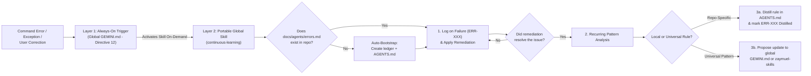

# Continuous Learning: Generic Error-to-Rule Distillation Workflow

## Purpose & Two-Layer Architecture

To avoid hardcoding project-specific fixes in the global system prompt, continuous self-improvement operates via a **two-layer architecture**:

1. **Layer 1 — Lightweight Always-On Trigger (`~/.gemini/GEMINI.md` Directive 12):** Remains active in every session with minimal token overhead (~4 lines), routing any command failure, unexpected exception, or user correction to this skill.
2. **Layer 2 — On-Demand Portable Skill (`continuous-learning`):** Loaded via progressive disclosure only when an incident occurs, handling repository auto-bootstrap, structural classification, and rule distillation.



Every workspace maintains **two complementary, non-overlapping files**:

| File | Functional Role | What Belongs Here | What Does NOT Belong Here |
| :--- | :--- | :--- | :--- |
| **`docs/agents/errors.md`** | **Incident Ledger & Empirical Memory (_Why rules exist_)** | Chronological `ERR-XXX` table of concrete failures, stack traces, root causes, one-off fixes, and empirical pitfalls observed in this repo. | Prescriptive workflow mandates mixed into log tables without synthesis. |
| **`AGENTS.md`** | **Enforced Operational Contract (_What the agent must obey_)** | Distilled, concise, imperative preventive rules promoted from validated patterns in `docs/agents/errors.md`. | Raw stack traces, historical command logs, or unanalyzed one-off bugs. |

---

## When to Trigger

Activate this skill **immediately before retrying or proceeding** whenever ANY of the following occurs in any repository:

1. A shell command, build step, script, or test returns a non-zero exit code or exception.
2. You reference a non-existent symbol, config constant, dependency, or wrong data schema from assumption instead of inspection.
3. A test mutates or overwrites production files/outputs.
4. The user corrects a recurring mistake or points out a boundary violation (e.g., documentation hygiene, path assumptions, polarity errors).

---

## 4-Step Execution Loop (`Bootstrap -> Log -> Analyze -> Distill`)

### Step 0: Cross-Repo Auto-Bootstrap

On the first failure in any new repository:

1. Check if `docs/agents/errors.md` exists. If absent, create `docs/agents/errors.md` using the **Ledger Bootstrap Template** below.
2. Ensure root `AGENTS.md` exists and links to `docs/agents/errors.md` (creating a minimal policy file if missing).

### Step 1: Immediate Capture (_Log on Failure_)

Before applying a fix or retrying a failed action, append one structured row to the incident table in `docs/agents/errors.md`:

- **ID:** Sequential (`ERR-001`, `ERR-002`, ...).
- **Context / Action:** Exact script, CLI command, or file operation attempted.
- **Exact Error / Symptom:** Verbatim exception class/message or observed defect.
- **Root Cause:** Underlying structural mechanism (not just "typo").
- **Immediate Remediation:** Targeted patch applied now.
- **Extracted Principle / Pattern:** Language-independent structural category (`[PATH-ENV]`, `[MISSING-DEP]`, `[API-CONTRACT]`, `[TEST-ISOLATION]`, `[DOC-BOUNDARY]`, `[SYMBOL-CHECK]`, `[DATA-SCHEMA]`, `[TOOLCHAIN]`) and general takeaway.
- **Status:** Set `⏳ Monitoring` for isolated first-time events, or `✅ Distilled` once promoted to a rule.

### Step 2: Cross-Incident Pattern Analysis

Scan existing rows in `docs/agents/errors.md`:

- **Recurrence Check:** Have $\ge 2$ incidents shared the same abstract category or failure mode?
- **Severity Check:** Is this a high-impact silent failure (e.g., silent data corruption, false scientific claim, destructive file overwrite, or user reporting an _"n-th time"_ mistake)?
- **Abstract the Solution:** Convert the concrete symptom (e.g., _"forgot `sys.path` in `Python-drafts/05.py`"_) into a reusable engineering check (_"Verify runtime import/working-directory assumptions or package layout before executing subfolder scripts"_), avoiding brittle one-off global patches.

### Step 3: Verification Gate & Rule Distillation

**Only after verifying that the immediate remediation actually resolved the failure** (e.g., the retried command, build, or test succeeds without regression) and Step 2 triggers promotion (recurrence $\ge 2$, critical silent failure, or explicit user request):

1. **Repository-Specific Rule -> Update `AGENTS.md`:**
   Add one concise, testable bullet under `AGENTS.md` and mark matching `ERR-XXX` rows as `✅ Distilled in AGENTS.md`.
2. **Cross-Project / Universal Rule -> Propose Global Promotion:**
   If the rule applies regardless of language, repo, or domain, propose adding it to `~/.gemini/GEMINI.md` or the appropriate global skill in `zaymuel-skills`, and mark `✅ Distilled globally`.
   _(Never distill an unverified or failed hypothesis into `AGENTS.md` or `GEMINI.md`; if the remediation fails, update the `ERR-XXX` root cause or log the follow-up failure first.)_

---

## Ledger Bootstrap Template (`docs/agents/errors.md`)

````markdown
# Agent Error Ledger & Distilled Pitfalls (`docs/agents/errors.md`)

**Purpose of this File:** Historical incident ledger and empirical knowledge base tracking concrete execution failures, root causes, and known pitfalls observed in this repository. Validated recurring patterns here are distilled into active mandatory rules in [`AGENTS.md`](../../AGENTS.md).

## 1. Entry Template (Copy for New Incidents)

```markdown
| **ERR-XXX** | YYYY-MM-DD | [Context / Command] | [Error / Symptom] | [Root Cause] | [Immediate Fix] | **[CATEGORY]:** [Principle] | ⏳ Monitoring / ✅ Distilled |
```

## 2. Incident Ledger

| ID | Date | Context / Action | Error / Symptom | Root Cause | Immediate Remediation | Abstract Principle / Category | Status |
| :---: | :---: | :--- | :--- | :--- | :--- | :--- | :---: |
| **ERR-001** | YYYY-MM-DD | ... | ... | ... | ... | **[CATEGORY]:** ... | ⏳ Monitoring / ✅ Distilled |
````
